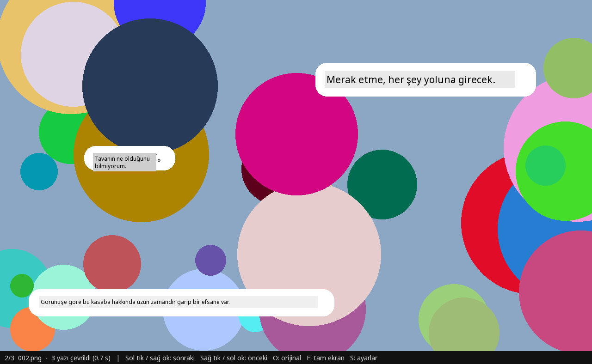
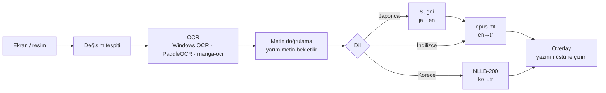
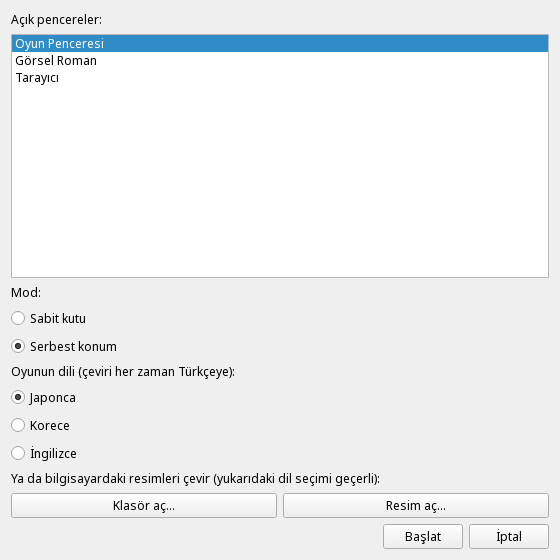
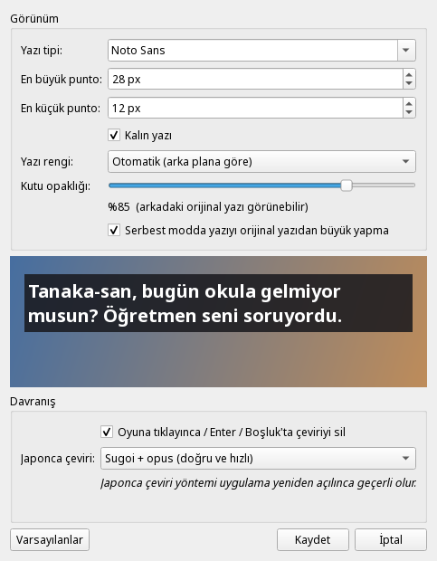

# Oyun Çevirmeni — Japonca / Korece / İngilizce → Türkçe

**Oyunlardaki, görsel romanlardaki ve resimlerdeki yazıyı ekrandan okuyup Türkçe çevirisini
yazının tam üstüne çizen, tamamen internetsiz çalışan bir Windows uygulaması.**


<p align="center">
  
</p>

## Neden?

Japonca oyunların çoğunun Türkçesi yok. Çevrimiçi çeviri araçları ise ekrandaki metni bir
sunucuya gönderiyor. Bu uygulama:

- **Hiçbir şeyi internete göndermez.** Modeller bir kez indirilir, sonra tamamen bilgisayarda çalışır.
- **Kayıt tutmaz.** Ekran görüntüsü, okunan metin ve çeviri yalnızca bellekte durur; diske yazılmaz.
- **İçerik filtresi yoktur.** Metin olduğu gibi çevrilir.
- **Ekran kartına dokunmaz.** Her şey işlemcide çalışır; oyunun GPU'su oyuna kalır.

## Özellikler

| | |
|---|---|
| 🎮 **Serbest konum modu** | Ekrandaki yazıyı okur (OCR), her yazının üstüne kendi çevirisini çizer. Pencere taşınınca takip eder, tıklamalar oyuna geçer. |
| 📋 **Sabit kutu modu** | [Textractor](https://github.com/Artikash/Textractor) ile oyundan çekilen metni panodan alıp sabit bir kutuda gösterir. |
| 🖼️ **Resim modu** | Klasördeki resimleri tıklayarak gezer; resmin her yerindeki büyük-küçük yazıları çevirir. Sonraki resimler arka planda hazırlanır. |
| 📖 **Manga desteği** | Dikey yazı ve furigana için balon balon okuyan [manga-ocr](https://github.com/kha-white/manga-ocr). |
| ⌨️ **Akıllı tıklama** | Yazı akarken tıklarsanız tamamını hemen çevirir; sayfa değişince eski çeviriyi siler. |
| 🧠 **Yarım metni çevirmez** | Harf harf akan yazı bitmeden çeviri yapılmaz; OCR gürültüsü çeviriyi titretmez. |
| 🎨 **Ayarlar penceresi** | Yazı tipi, punto, renk, kutu opaklığı… değişiklikler ekrana anında yansır. |
| 📚 **Sözlük** | İsimleri sabitleyin: `{"イルカ": "Iruka"}`. |

## Nasıl çalışır?



Tüm modeller [CTranslate2](https://github.com/OpenNMT/CTranslate2) ile işlemcide çalışır.
Japonca için doğrudan çeviri yerine **İngilizce üzerinden iki adımlı zincir** kullanılır:
NLLB'nin Japoncası zayıf, oysa Japonca→İngilizce (Sugoi) ve İngilizce→Türkçe (opus-mt) adımları
hem daha doğru hem ~3 kat daha hızlı.

## Ekran görüntüleri

| Başlangıç ekranı | Ayarlar (Ctrl+Alt+S) |
|---|---|
|  |  |

## Kurulum

Gerekenler: **Windows 10 (2004+) / 11**, **Python 3.11**, kurulum için internet.

```powershell
git clone https://github.com/Dev-Mustafaa/game-translator-tr.git
cd game-translator-tr
py -3.11 setup.py                    # venv, NLLB, opus-mt, font
py -3.11 setup.py --sugoi            # Japonca için önerilir (lisansa bakın)
py -3.11 setup.py --paddle --manga   # resim modu / manga için (isteğe bağlı)
```

Windows OCR'da oyunun dili yoksa (yönetici PowerShell'de):

```powershell
Add-WindowsCapability -Online -Name "Language.OCR~~~ja-JP~0.0.1.0"
```

## Kullanım

`baslat.bat`'a çift tıklayın → oyun penceresini, modu ve dili seçin → **Başlat**.
Resimler için aynı ekrandan **Klasör aç...** / **Resim aç...**

| Kısayol | İş |
|---|---|
| `Ctrl+Alt+S` | Ayarlar |
| `Ctrl+Alt+E` | Düzenleme: taranacak alanı / sabit kutuyu çiz |
| `Ctrl+Alt+T` | Çeviriyi gizle / göster |
| `Ctrl+Alt+M` | Sabit kutu ↔ serbest konum |
| `Ctrl+Alt+R` | Hemen yeniden çevir |
| `Ctrl+Alt+D` | Süre göstergesi |
| `Ctrl+Alt+Q` | Çıkış |

> **İpucu:** Yazılar hep aynı diyalog kutusunda çıkıyorsa `Ctrl+Alt+E` ile alanı o kutuya
> sınırlayın — OCR birkaç kat hızlanır, arka plandan yanlış okuma biter.
> Laptopta **şarj takılıyken** çeviri pildekinden ~5 kat hızlıdır.

Ayrıntılar: **[Kullanım kılavuzu](docs/KULLANIM.md)** · Yapım raporu: [RAPOR.md](RAPOR.md) ·
Yol haritası: [YOL_HARITASI.md](YOL_HARITASI.md)

## Performans

Ölçümler: i7-12650H, 16 GB RAM, **prizde**.

| | Süre |
|---|---|
| Japonca çeviri (Sugoi + opus, cümle başı) | ~210 ms |
| Yazı bittikten sonra çevirinin ekrana gelmesi | ~0.5–1 s |
| "Tamamla" tıkından sonra | ~0.6 s |
| Resim (sayfa başı, Windows OCR) | ~0.5–0.7 s |

## Proje yapısı

```
src/
  app.py            ana döngü, kısayollar, seçim ekranı
  imagemode.py      resim modu (görüntüleyici + arka plan işçisi)
  translate/        NLLB, Sugoi, opus-mt, zincir kurucu, önbellek, sözlük
  ocr/              Windows OCR, PaddleOCR, manga OCR, satır birleştirme, metin doğrulama
  capture/          ekran yakalama, değişim tespiti
  overlay/          şeffaf pencere, metin sığdırma, ayarlar penceresi
tools/              benchmark, sahte oyun (testler için)
tests/              birim ve uçtan uca testler
```

Testler: `venv\Scripts\python.exe -m pytest tests` — uçtan uca testler fareyi ve panoyu kullanır.

## Modeller ve lisansları

Modeller depoda yoktur; `setup.py` kurulumda indirir.

| Model | Kullanım | Lisans |
|---|---|---|
| [NLLB-200 distilled](https://huggingface.co/facebook/nllb-200-distilled-1.3B) | Korece ve yedek çeviri | CC-BY-NC 4.0 (ticari olmayan) |
| [opus-mt-tc-big-en-tr](https://huggingface.co/Helsinki-NLP/opus-mt-tc-big-en-tr) | İngilizce → Türkçe | CC-BY 4.0 |
| [Sugoi v4 ja-en](https://huggingface.co/entai2965/sugoi-v4-ja-en-ctranslate2) | Japonca → İngilizce | NTT JParaCrawl: yalnızca araştırma amaçlı, ticari değil |
| [manga-ocr-base](https://huggingface.co/kha-white/manga-ocr-base) | Manga OCR | Apache-2.0 |
| [PaddleOCR](https://github.com/PaddlePaddle/PaddleOCR) | OCR (isteğe bağlı) | Apache-2.0 |
| [Noto Sans](https://fonts.google.com/noto/specimen/Noto+Sans) | Overlay yazı tipi | SIL OFL 1.1 |

Bu proje kişisel kullanım içindir; modellerin lisansları ticari kullanıma izin vermez.

## Bilinen sınırlar

- Tek monitör; exclusive fullscreen oyunlarda overlay görünmez (pencereli / çerçevesiz kullanın).
- Eğik ya da süslü yazılar (manga efekt sesleri) hatalı okunabilir.
- Çeviri bağlam bilmez; isimler için sözlük gerekir.
